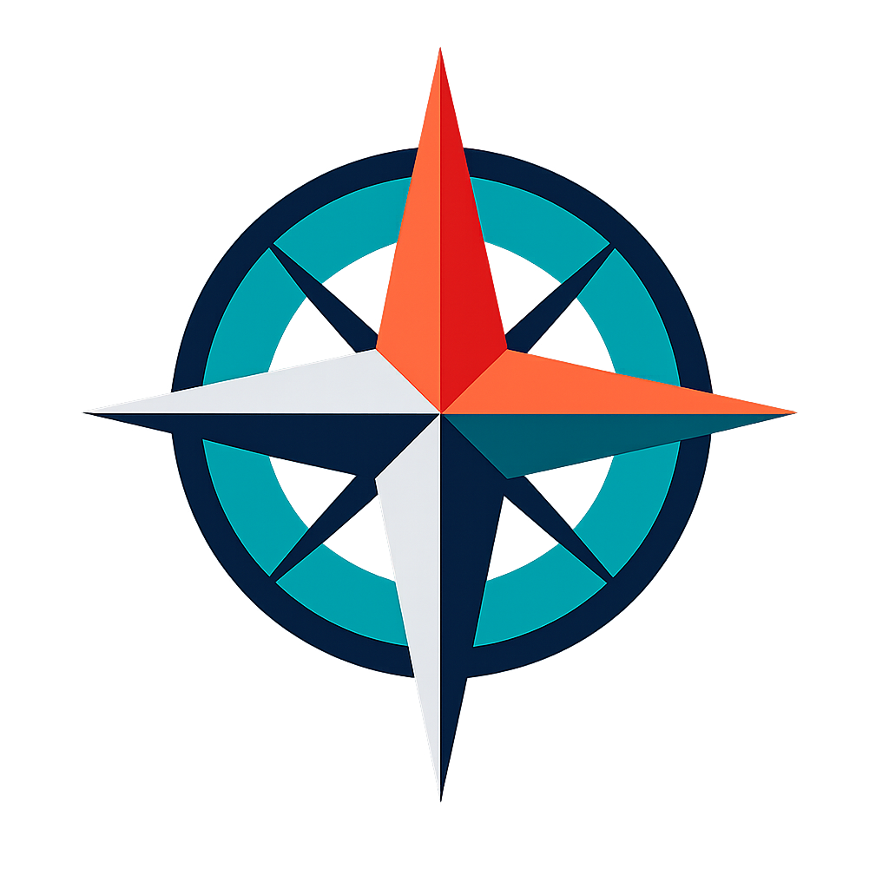
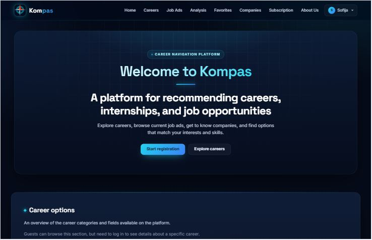
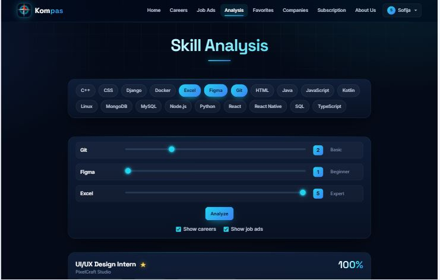
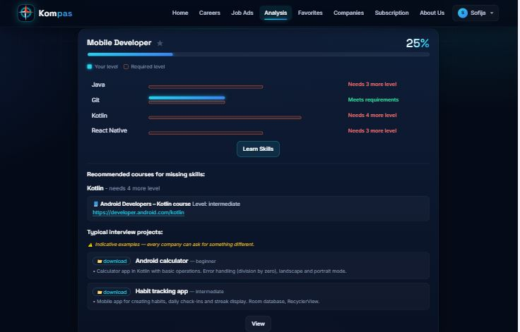
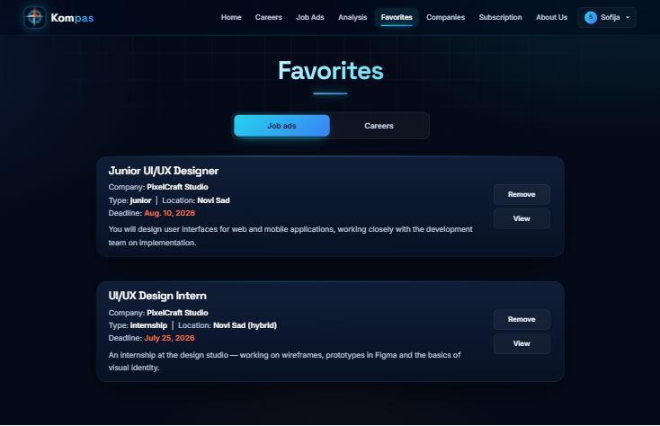
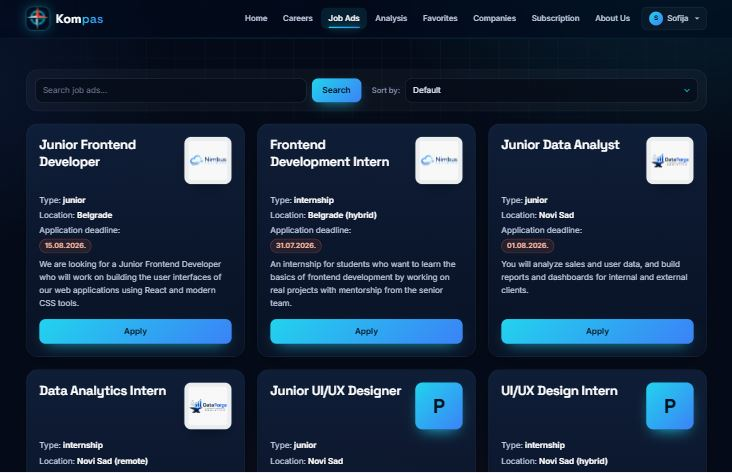
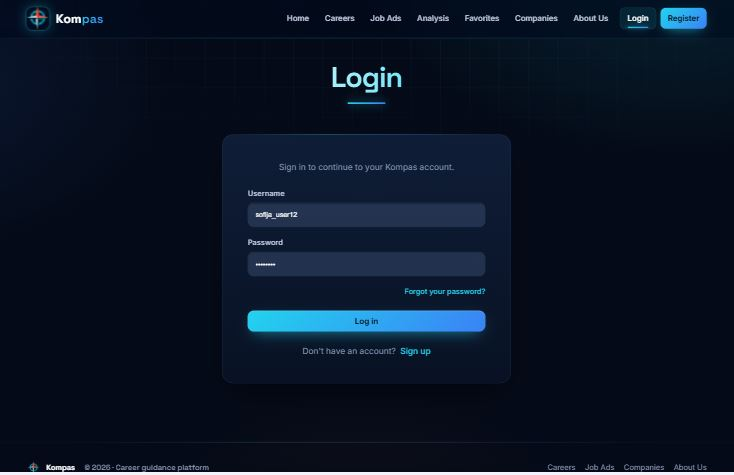
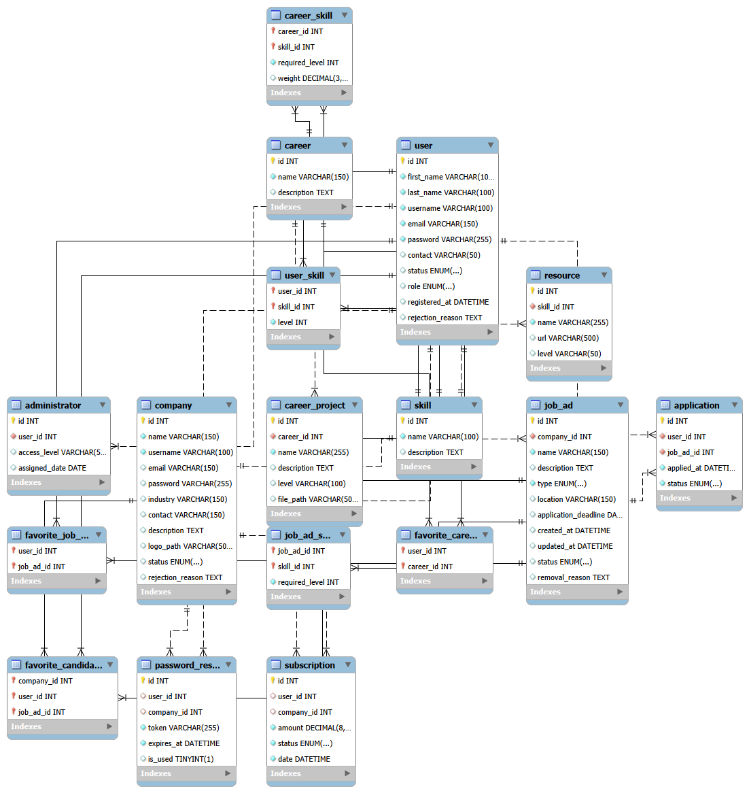

<div align="center">



# Kompas

**A career guidance platform that helps students and juniors explore IT careers, measure their skills and find internships and junior jobs.**


</div>

<!-- SCREENSHOT: hero image of the landing page (/accounts-app/index/) -->


---

## Table of contents

- [About the project](#about-the-project)
- [Features](#features)
- [Screenshots](#screenshots)
- [Tech stack](#tech-stack)
- [Project structure](#project-structure)
- [Getting started](#getting-started)
- [Test accounts](#test-accounts)
- [Resetting the database after model changes](#resetting-the-database-after-model-changes)
- [Running the tests](#running-the-tests)
- [Project documentation](#project-documentation)
- [Team](#team)

---

## About the project

Kompas ("compass") connects three groups of people:

- **Users** who are choosing a career path. They can browse IT careers, run a skill analysis that shows how well they match each career and job ad, get learning resources for missing skills, save favorites and apply for jobs.
- **Companies** who publish internships and junior positions and review the candidates who applied.
- **Administrators** who approve company registrations, moderate job ads and manage accounts, careers and skills.

The project was built by team **MAMS** as a university team project.

## Features

### Guests
- Landing page with careers, current job ads, companies and smart filtering
- Browse careers, job ads and companies
- Registration as a **user** or a **company**, followed by a (simulated) registration payment

### Users
- **Skill analysis** – pick your skills, set your level (1–5) and see a ranked match percentage for every career and job ad, with a per-skill breakdown
- **Learn skills** – recommended courses for every missing skill and typical interview projects (downloadable)
- **Favorites** – save careers and job ads and jump straight back to them
- **Job applications** with CV upload and a cover message
- Profile editing and subscription management

### Companies
- Dashboard with statistics (active ads, candidates, new today, expiring deadlines)
- Create, edit and delete job ads with required skills and levels
- Review candidates per job ad, **accept / reject / move back to review**, and mark favorite candidates

### Administrators
- Dashboard with a system overview
- Create user and company accounts
- Approve or reject company registrations
- Moderate job ads (remove or mark as outdated)
- Manage accounts and roles
- Manage careers and their required skills

## Screenshots

| Skill analysis – choosing skills and levels | Skill analysis – match breakdown and learning resources |
|:---:|:---:|
|  |  |
| **Favorites** | **Job ads** |
|  |  |
| **Login** | **Landing page** |
|  |  |

<!-- Optional: database model -->
<details>
<summary><b>Database model</b></summary>



</details>

## Tech stack

| Layer | Technology |
|---|---|
| Backend | Python 3.12+, Django 6.0 |
| Database | MySQL 8 (`mysqlclient`) |
| Frontend | Django templates, Bootstrap 5.3, vanilla JavaScript |
| Design | Custom dark theme (`compass_app/accounts/static/css/kompas-theme.css`), fonts Inter & Space Grotesk |

## Project structure

```
compass-skill-gap-analyzer/
├── README.md
├── compass_app/                # the Django application
│   ├── config/                 # Django settings and root URLs
│   ├── accounts/               # landing page, login, registration, payment, profile, subscription
│   ├── careers/                # skill analysis, favorites, project downloads
│   ├── jobs/                   # careers & companies pages, job ads, applications, company dashboard
│   ├── administration/         # admin panel (requests, moderation, accounts, careers)
│   ├── templates/base.html     # shared layout: navigation, footer, global theme
│   ├── projects_for_careers/   # downloadable interview projects (MEDIA_ROOT)
│   ├── additional_files/       # database model, SQL schema and seed data
│   ├── docs/screenshots/       # images used in this README
│   ├── manage.py
│   └── requirements.txt
└── ...                         # project documentation (see below)
```

## Getting started

### 1. Prerequisites

- **Python 3.12 or newer** (required by Django 6)
- **MySQL Server 8** (and optionally MySQL Workbench)
- Git

### 2. Clone the repository

```bash
git clone https://github.com/<your-username>/<repository-name>.git
cd <repository-name>/compass_app
```

All commands below are run from the `compass_app` folder (the one that contains `manage.py`).

### 3. Create a virtual environment and install dependencies

**Windows**
```powershell
py -m venv venv
venv\Scripts\activate
pip install -r requirements.txt
```

**macOS / Linux**
```bash
python3 -m venv venv
source venv/bin/activate
pip install -r requirements.txt
```

### 4. Create the database

In MySQL (Workbench or the command line):

```sql
CREATE DATABASE kompas;
```

Then check the connection settings in `config/settings.py` and change `USER` and `PASSWORD` to match your local MySQL installation:

```python
DATABASES = {
    'default': {
        'ENGINE': 'django.db.backends.mysql',
        'NAME': 'kompas',
        'USER': 'root',
        'PASSWORD': '123',
        'HOST': '127.0.0.1',
        'PORT': '3306',
    }
}
```

### 5. Create the tables

From the `compass_app` folder (the one with `manage.py`):

```bash
py manage.py migrate
```

### 6. Load the seed data

Run `additional_files/seed_full_en.sql` against the `kompas` database. It fills skills, careers, career–skill links, learning resources, interview projects, companies and job ads.

> **MySQL Workbench error 1175 (safe update mode)?** Run this first, then run the script again:
> ```sql
> SET SQL_SAFE_UPDATES = 0;
> ```

From the command line you can also do:

```bash
mysql -u root -p kompas < additional_files/seed_full_en.sql
```

### 7. Create the test accounts

```bash
py manage.py seed_accounts
```

### 8. Run the server

```bash
py manage.py runserver
```

Open **http://127.0.0.1:8000/accounts-app/index/** for the landing page, or **http://127.0.0.1:8000/accounts-app/login/** to log in.

> On macOS / Linux use `python` instead of `py` in all commands.

## Test accounts

`py manage.py seed_accounts` creates the following accounts. The password for **all** of them is **`test1234`**.

| Username | Role | Note |
|---|---|---|
| `sofija_user` | User | |
| `marko_user` | User | |
| `ana_admin` | Administrator | opens the admin panel at `/administration/` |
| `nimbus_company` | Company | active |
| `dataforge_company` | Company | **pending** – log in as `ana_admin` and approve it under *Company registrations* first |

## Resetting the database after model changes

When you pull changes that modify the models, reset your local database so it matches the new structure:

```bash
git pull origin master
```

```sql
DROP DATABASE kompas;
CREATE DATABASE kompas;
```

```bash
py manage.py migrate
# run additional_files/seed_full_en.sql again (with SET SQL_SAFE_UPDATES = 0; if needed)
py manage.py seed_accounts
```

## Running the tests

```bash
py manage.py test
```

Some tests in `careers/tests.py` and `administration/tests/` are end-to-end browser tests. They need Selenium and Google Chrome:

```bash
pip install selenium
```

Django creates a separate test database automatically, so the MySQL user needs permission to create databases.

## Project documentation

Kompas was developed as a **university team project**, so the repository also contains the documentation that was submitted alongside the code (project assignment, use case scenario specifications, prototype, UML diagrams, testing reports, database model…). Because it was written for the course, some of these documents may be **in Serbian**.

## Team

**Team MAMS** – **M**ilica, **A**nastasija, **M**ina, **S**ofija

The work was split by Django app – every member built her module end-to-end (models, views, templates, URLs and seed data).

| Member | App | Main area |
|---|---|---|
| **Sofija Nikolić** | `accounts` | Login for users and companies, sessions and role-based access, user and company registration, password reset, registration payment and subscriptions, user and company profiles, landing and About Us pages |
| **Milica Pavlović** | `administration` | Admin dashboard with system statistics, creating accounts, approving or rejecting company registrations, job ad moderation, managing accounts and roles, managing careers and their skills |
| **Mina Ostojić** | `jobs` | Job ads (search, sort, applying with a CV), company dashboard, creating, editing and deleting job ads, reviewing candidates and favorite candidates, companies list, careers list and career details |
| **Anastasija Ljubičić** | `careers` | Skills and careers models, the skill analysis (matching) algorithm with ranking of careers and job ads, learning resources and interview projects for missing skills, favorites (job ads and careers), seed data (`seed_full_en.sql`), tests for the administration module |

---

<div align="center">
<sub>Made with ☕ by team MAMS</sub>
</div>
